<picture><source media="(prefers-color-scheme: dark)" srcset="assets/hero-dark.svg"></picture>

<a href="../../releases"><picture><source media="(prefers-color-scheme: dark)" srcset="assets/download-dark.svg"></picture></a>

<picture><source media="(prefers-color-scheme: dark)" srcset="assets/about-dark.svg"></picture>

<picture><source media="(prefers-color-scheme: dark)" srcset="assets/flow-dark.svg"></picture>

<picture><source media="(prefers-color-scheme: dark)" srcset="assets/install-dark.svg"></picture>

<picture><source media="(prefers-color-scheme: dark)" srcset="assets/tech-tab-dark.svg"></picture>

<picture><source media="(prefers-color-scheme: dark)" srcset="assets/tech-body-dark.svg"></picture>

<picture><source media="(prefers-color-scheme: dark)" srcset="assets/guide-tab-dark.svg"></picture>

<picture><source media="(prefers-color-scheme: dark)" srcset="assets/guide-body-dark.svg"></picture>

<a href="../../releases"><picture><source media="(prefers-color-scheme: dark)" srcset="assets/download-dark.svg"></picture></a>

<picture><source media="(prefers-color-scheme: dark)" srcset="assets/demo-tab-dark.svg"></picture>

<picture><source media="(prefers-color-scheme: dark)" srcset="assets/demo-body-dark.svg"></picture>

<picture><source media="(prefers-color-scheme: dark)" srcset="assets/flow-dark.svg"></picture>

<!-- Замените схему на  после добавления записи. -->

<picture><source media="(prefers-color-scheme: dark)" srcset="assets/warning-tab-dark.svg"></picture>

<picture><source media="(prefers-color-scheme: dark)" srcset="assets/warning-body-dark.svg"></picture>

<picture><source media="(prefers-color-scheme: dark)" srcset="assets/legal-tab-dark.svg"></picture>

<picture><source media="(prefers-color-scheme: dark)" srcset="assets/legal-body-dark.svg"></picture>

<a href="LICENSE"><picture><source media="(prefers-color-scheme: dark)" srcset="assets/license-dark.svg"></picture></a> <a href="LICENSE_ru"><picture><source media="(prefers-color-scheme: dark)" srcset="assets/license-ru-dark.svg"></picture></a>

<picture><source media="(prefers-color-scheme: dark)" srcset="assets/footer-dark.svg"></picture>

