<picture><source media="(prefers-color-scheme: dark)" srcset="assets/hero-dark.svg"></picture>

<a href="../../releases"><picture><source media="(prefers-color-scheme: dark)" srcset="assets/download-dark.svg"></picture></a>

<picture><source media="(prefers-color-scheme: dark)" srcset="assets/about-dark.svg"></picture>

<picture><source media="(prefers-color-scheme: dark)" srcset="assets/flow-dark.svg"></picture>

<picture><source media="(prefers-color-scheme: dark)" srcset="assets/install-dark.svg"></picture>

<b>Техническая часть</b>

По описанию автора, FuckVoice перехватывает пакеты при подключении и подменяет идентификатор лаунчера на маркер, ожидаемый сервером от KLauncher. Реализация, совместимые версии Minecraft и зависимости уточняются в конкретном релизе.

<b>Установка — текстовая инструкция</b>

1. Скачайте подходящий `.jar` со страницы [Releases](../../releases).
2. Поместите файл в папку `mods` игрового профиля **Fabric**.
3. Проверьте требования выбранного релиза к версии Minecraft и зависимостям.
4. Запустите профиль Fabric и подключитесь к EnvyWorld.

Лаунчеры Modrinth, Prism и TL Legacy указаны как варианты запуска. Обычный Vanilla-профиль без загрузчика Fabric не загружает этот мод.

<b>Демонстрация игрового процесса</b>

Запись пока не добавлена. Схема выше иллюстрирует принцип работы.
<!-- Когда запись будет готова, замените эту строку:  -->

### Дисклеймер

Использование мода может нарушать правила EnvyWorld и привести к блокировке аккаунта. Автор не несёт ответственности за последствия использования.

### Лицензия

Условия распространения указаны в [LICENSE](LICENSE) и [LICENSE_RU](LICENSE_ru).

<picture><source media="(prefers-color-scheme: dark)" srcset="assets/footer-dark.svg"></picture>

